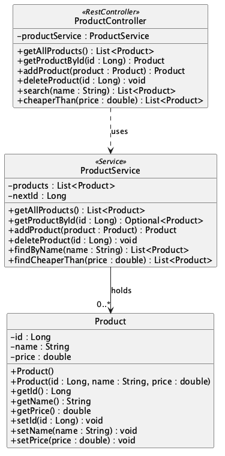

# ProductController, ProductService and Product — UML class diagram

The controller depends on the service (dashed arrow). The service holds the products (solid arrow). Nothing points back to the controller.

Source: [`ProductService.puml`](ProductService.puml)
